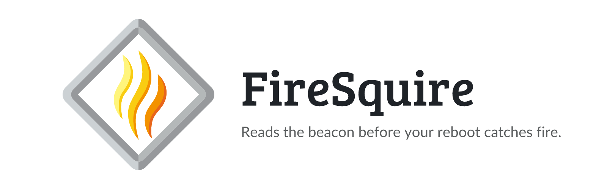

<p align="center">
  <picture>
    <source media="(prefers-color-scheme: dark)" srcset="https://raw.githubusercontent.com/junkerderprovinz/firesquire/main/.github/assets/banner-dark.png">
    
  </picture>
</p>

<p align="center">
  <a href="https://github.com/junkerderprovinz/firesquire/actions/workflows/release.yml"></a>&nbsp;
  <a href="https://github.com/junkerderprovinz/firesquire/actions/workflows/lint.yml"></a>&nbsp;
  <a href="https://unraid.net"></a>&nbsp;
  <a href="https://github.com/junkerderprovinz/firesquire/releases"></a>&nbsp;
  <a href="LICENSE"></a>
</p>

<p align="center">
An Unraid plugin that answers one question before you reboot: <b>will the box come back up clean?</b><br>
FireSquire reads the live host state and gives you a single verdict (<b>GO / CAUTION / NO-GO</b>) with the exact findings, so you never reboot into a known landmine. Advisory only: it reads the host. On the flash it writes a test file that it deletes right away, and it keeps the CRC error count of each disk there, so it notices when one rises.
</p>

<br>

<p><a id="table-of-contents" href="#table-of-contents"><picture><source media="(prefers-color-scheme: dark)" srcset=".github/assets/sections/table-of-contents-dark.svg"></picture></a></p>

1. [Support](#1-support)
2. [What is this?](#2-what-is-this)
3. [Screenshots](#3-screenshots)
4. [What it checks](#4-what-it-checks)
5. [How it works](#5-how-it-works)
6. [Install](#6-install)
7. [Development](#7-development)
8. [License](#8-license)
9. [How AI is used here](#9-how-ai-is-used-here)

<br>

<p><a id="1-support" href="#1-support"><picture><source media="(prefers-color-scheme: dark)" srcset=".github/assets/sections/1-support-dark.svg"></picture></a></p>

<p align="center">
A one-knight job: I build it, keep it running, work through the issues and add what people ask for, until nothing is missing. It is free, with no accounts, no telemetry, no ads and no paid tier. No asterisk anywhere. Nothing readable ever leaves your own walls. Forged on evenings and weekends, with heart and stubbornness.
</p>

<p align="center">
If it has earned a place on your server or computer, toss a coin to your knight: it helps cover the costs and keeps the project alive. It also makes this knight's heart beat a little faster. Three ways below, whichever suits you.
</p>

<p align="center">
  <a href="https://buymeacoffee.com/junkerderprovinz"></a>
  &nbsp;
  <a href="https://www.paypal.com/donate/?hosted_button_id=76FVV52TKXTUS"></a>
  &nbsp;
  <a href="https://junkerderprovinz.github.io/junkerderprovinz/"></a>
</p>

<br>

<p><a id="2-what-is-this" href="#2-what-is-this"><picture><source media="(prefers-color-scheme: dark)" srcset=".github/assets/sections/2-what-is-this-dark.svg"></picture></a></p>

A reboot is never 100% guaranteed, but a large class of "it didn't come back right" is **predictable from the current live state**. FireSquire inspects that state before you reboot and gives you a single, honest verdict:

- **GO**: nothing found that should block a reboot
- **CAUTION**: non-fatal issues you should know about first
- **NO-GO**: conditions likely to make the reboot come back dirty

It is **advisory only**. It reads the system and reports. It never stops, mounts or unmounts anything, because acting on the host is exactly what tends to cause reboot trouble in the first place. It writes two things to the flash. One is the flash write test, an empty file on `/boot` that it deletes as soon as it has been created. The other is `crc.state` in `/boot/config/plugins/firesquire`, with the CRC error count of each disk, so it can tell when one rises. It rewrites that file only when a count changes.

The plugin adds a **FireSquire** button next to *Reboot* on the **Main** tab, a flame icon next to *Reboot* in the server tile on the **Dashboard**, and a **Settings → User Utilities → FireSquire** page with a short description. Click any of them and a **live progress bar** shows each check as it runs, then read the verdict and reboot. Each problem finding is a **click-through link** straight to the page where you fix it: syslog and disk/IO findings open the System Log viewer, array/parity/SMART/space findings open Main, running VMs open the VMs tab, and so on. The report follows your Unraid light/dark theme and **the language configured in the Unraid UI** (all 26 supported languages, English fallback).

<br>

<p><a id="3-screenshots" href="#3-screenshots"><picture><source media="(prefers-color-scheme: dark)" srcset=".github/assets/sections/3-screenshots-dark.svg"></picture></a></p>

<p align="center">
  
  <br><em>The pre-reboot report: a single GO / CAUTION / NO-GO verdict with the exact checks behind it. Advisory only: apart from a flash write test it removes at once and the CRC counts it keeps, it changes nothing.</em>
</p>

<br>

<p align="center">
  
  <br><em>One click from the Main tab: the FireSquire button sits right next to Reboot.</em>
</p>

<br>

<p><a id="4-what-it-checks" href="#4-what-it-checks"><picture><source media="(prefers-color-scheme: dark)" srcset=".github/assets/sections/4-what-it-checks-dark.svg"></picture></a></p>

**Critical: a failure here means NO-GO**

- Array started and clean (no disabled / invalid / missing disks)
- No parity check / sync / rebuild / clear in progress, mover not running
- No container mounting a host runtime directory (`/var/run`, `/run`, `/var/run/libvirt`, …, with `docker.sock` excepted), the bind class that can take libvirt/docker down on reboot
- No stuck `docker.img` / `libvirt.img` loop (attached-but-not-mounted, or a loop backing a deleted file)
- Flash `/boot` mounted and writable
- ZFS pools not degraded, faulted or unavailable, and no ZFS device with read, write or checksum errors
- No btrfs device with errors in `btrfs device stats`

**Caution: worth knowing before you reboot**

- Crashes since last boot in the syslog (segfault, general-protection-fault, OOM, kernel panic, call traces)
- Low free space on `/`, `/var/log` (both RAM), `docker.img`, cache
- VMs currently running (a reboot force-stops them)
- A core service down right now (dockerd / libvirtd / emhttpd)
- Container bind sources under `/mnt` that no longer exist
- SMART health (`smartctl -H`) on every disk
- A UDMA CRC error count that rose since the last check, which usually means a bad cable or port

Every disk finding names the port from `/dev/disk/by-path`, such as `sdc [pci-0000:00:17.0-ata-3]`, so you know which cable to look at. When a disk check finds something, FireSquire links to Scrutiny if it runs on the server, or suggests it for the SMART history.

**Your fortress**: if FireSquire has joined a fortress, it asks the other apps there what they are doing. Work a reboot would cut short, such as a running backup, is NO-GO and names the app, the device, the task and its progress. An app that reports an error waiting for you is CAUTION. Without a fortress the group stays out of the report.

**Info**: uptime, kernel, Unraid version.

### Honest limits

This is an early-warning check, not an oracle. Genuine hardware, BIOS or timing failures during boot cannot be seen from a running system. What it *does* cover reliably is the state-detectable class: pinned mounts, stuck loops, an unclean array, in-flight array operations, a low-on-RAM or crash-looping box.

<br>

<p><a id="5-how-it-works" href="#5-how-it-works"><picture><source media="(prefers-color-scheme: dark)" srcset=".github/assets/sections/5-how-it-works-dark.svg"></picture></a></p>

A single Bash engine (`firesquire-check.sh`) runs the checks by querying the tools Unraid already ships: `mdcmd`, `losetup`, `docker`, `smartctl`, `df`, `pgrep`. No daemon. For the fortress it calls the small `fortress` helper, which the plugin downloads from ParleyPort's releases. It prints a human-readable report on a console, or machine-readable JSON for the WebGUI:

```bash
firesquire-check.sh          # human-readable report
firesquire-check.sh --json   # machine-readable (used by the WebGUI)
```

Exit code mirrors the verdict: `0` = GO, `1` = CAUTION, `2` = NO-GO.

The WebGUI layer is a small PHP page (`FireSquireReport.php`) that runs the engine and renders the verdict in an Unraid modal.

<br>

<p><a id="6-install" href="#6-install"><picture><source media="(prefers-color-scheme: dark)" srcset=".github/assets/sections/6-install-dark.svg"></picture></a></p>

**Community Apps** *(planned)*: search for **FireSquire** in the Apps tab.

**By URL (today):** Unraid → **Plugins** → **Install Plugin**, paste:

```
https://raw.githubusercontent.com/junkerderprovinz/firesquire/main/plugin/firesquire.plg
```

<br>

<p><a id="7-development" href="#7-development"><picture><source media="(prefers-color-scheme: dark)" srcset=".github/assets/sections/7-development-dark.svg"></picture></a></p>

The plugin files live under [`src/`](src/) mirroring the on-disk layout
(`/usr/local/emhttp/plugins/firesquire/`). The release `.txz` is built by CI on
a tagged push (`v*`), built on Linux so executable bits are preserved.

Assets (icon, banner) are generated with
[`.github/assets/render-assets.mjs`](.github/assets/render-assets.mjs).

<br>

<p><a id="8-license" href="#8-license"><picture><source media="(prefers-color-scheme: dark)" srcset=".github/assets/sections/8-license-dark.svg"></picture></a></p>

**Copyright (C) 2026 Junker der Provinz.**

FireSquire is free software under the **GNU Affero General Public License v3.0** (AGPL-3.0); see [LICENSE](LICENSE). You may run, study, share and modify it. If you distribute it, or run a modified version as a network service, you must release your source under the same AGPL-3.0 terms and keep the existing copyright and attribution notices intact.

**Name and branding are not licensed.** The AGPL covers the source code only. "FireSquire", its logo and its branding remain reserved: a fork or derivative must use its own distinct name and branding, and may not present itself as FireSquire. This keeps it unambiguous which project is the original.

<br>

<p><a id="9-how-ai-is-used-here" href="#9-how-ai-is-used-here"><picture><source media="(prefers-color-scheme: dark)" srcset=".github/assets/sections/9-how-ai-is-used-here-dark.svg"></picture></a></p>

One knight builds this, and AI is one of the tools I work with, the same way I work with an editor or a compiler. It helps me write code and documentation and it checks my work, and that saves me a good many evenings. It does not make the decisions, though. I read and understand everything before it ships, and if something here breaks, that is on me and not on the tool.

You do not have to take my word for it. The code is open and every release note is written by hand. The issue tracker shows how problems actually get handled, including the ones I got wrong the first time. If you find something that is not right, open an issue and I will look at it.

<br>

Questions? Check the [support thread](https://forums.unraid.net/topic/199508-support-junkerderprovinz-firesquire/). Bugs, ideas or feature requests? Please [open a GitHub issue](https://github.com/junkerderprovinz/firesquire/issues).
